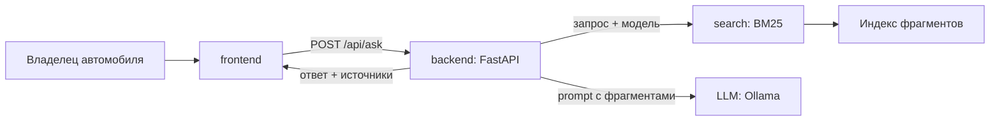

# ManualMate

Помощник по регламенту технического обслуживания автомобилей Mercedes-Benz. Отвечает на вопросы владельца по официальным документам: находит фрагменты руководств через BM25, формирует ответ с помощью LLM и показывает документ и страницу, на которые опирается ответ.


## Тема и пользователь

**Тема:** помощник для консультирования по регламенту технического обслуживания автомобилей.

**Модели в базе знаний:** Mercedes-Benz C-класс (W205), E-класс (W213), GLC (X253), 2014–2022 годы выпуска. Модели выбраны потому, что у них общие двигатели (M274, M264, OM654), а значит, одни и те же сведения о маслах, жидкостях и сервисах встречаются сразу в нескольких документах.

**Пользователь:** владелец одной из этих машин, который хочет понять, что и когда нужно делать на обслуживании: что входит в сервис A и сервис B, какое масло допускается для его двигателя, как читать сообщения ASSYST PLUS. Ему важно проверить ответ по первоисточнику, а не верить чат-боту на слово.

Пример: «Что входит в сервис B на E-классе с двигателем M264?» → краткий ответ, список работ, источники «Руководство по эксплуатации E-класса, стр. N».

## Что готово сейчас

| Материал | Статус |
| --- | --- |
| SDD и интерфейс КТ1 | Сохранены; прототип доступен с явным `?demo=1` |
| Backend | FastAPI: `/api/ask`, `/api/vehicles`, `/api/health`; также раздаёт интерфейс |
| Поиск | Собственные инвертированный индекс и BM25, лемматизация, синонимы, фильтр модели, JSON-кэш |
| LLM | Локальная Ollama, ответ по найденным карточкам, проверка сносок и чисел, отказ при отсутствии сведений |
| Корпус | 30 коротких адаптированных документов D01–D30 по трём русским руководствам; страницы и SHA-256 PDF проверяются скриптом |
| Benchmark | 10 обычных вопросов с ≥3 релевантными документами и эталонами, 5 ловушек; сохранённые прогоны и разбор — [benchmark/](benchmark/) |
| Проверки | Unit-тесты, API, браузерные сценарии 1440/390 px и CI; отчёт — [КТ2](docs/checkpoint-2.md) |

Корпус КТ2 охватывает отдельные вопросы ASSYST PLUS, моторного масла, давления шин и проверки охлаждающей жидкости. Это 30 индексируемых карточек из трёх PDF, не 30 полных руководств. В нём пока нет полного состава сервисов A/B, допусков по двигателям и всех интервалов ТО. На такие вопросы система должна отказать. Вкладки показывают издание руководства, к которому относится ответ; двигатель пока не указан.

## Запуск системы

Нужны Python 3.11+ и [Ollama](https://ollama.com/download). Команды выполняются из корня репозитория. Модель `qwen2.5:7b` занимает около 4,7 ГБ; для проверки использован компьютер с 16 ГБ памяти.

```bash
python3 -m venv .venv
source .venv/bin/activate
python -m pip install -r requirements.txt
ollama pull qwen2.5:7b
```

Запустите приложение Ollama либо `ollama serve` в отдельном терминале **до** команды `ollama pull`. После загрузки модели запустите приложение:

```bash
python -m uvicorn backend.app:app --host 127.0.0.1 --port 8000
```

Откройте <http://127.0.0.1:8000>. Готовые карточки уже в Git; скачивать PDF и собирать индекс вручную для первого запуска не нужно. Индекс появится в `.cache/index.json` и пересоберётся при изменении корпуса. Готовность проверяется по <http://127.0.0.1:8000/api/health>, контракт можно открыть в <http://127.0.0.1:8000/docs>.

Проверочный вопрос: «Где находится таблица рекомендованного давления шин?» → ответ, источник и раскрываемый фрагмент. Затем: «Сколько стоит ТО у дилера?» → отказ, «Какое масло?» → уточнение.

| Переменная backend | По умолчанию |
| --- | --- |
| `OLLAMA_URL` | `http://127.0.0.1:11434` |
| `OLLAMA_MODEL` | `qwen2.5:7b` |
| `LLM_TIMEOUT` | 120 секунд |
| `TOP_K`, `BM25_K1`, `BM25_B` | 5, 1.2, 0.75 |
| `BM25_MIN_SCORE` | 0.5, исходный порог без оптимизации на итоговом наборе |
| `FRONTEND_ORIGINS` | `http://localhost:8080,http://127.0.0.1:8080` для отдельного frontend |

Если Ollama или модель недоступна, вопросы с найденным контекстом возвращают 503 с возможностью повтора. Демо автоматически не включается. Не запускайте `--reload` при измерении времени benchmark.

## Запуск прототипа

Демо КТ1 можно открыть без Python-зависимостей и Ollama:

```bash
python3 -m http.server 8080 --directory frontend
```

Адрес: <http://localhost:8080/?demo=1>, ошибка: <http://localhost:8080/?demo=1&error=1>. Ответы и страницы в этом режиме — примеры, это видно в интерфейсе. Отдельный frontend с настоящим API настраивается через `frontend/config.js`, см. [frontend/README.md](frontend/README.md).

## Повтор проверки КТ2

```bash
python3 scripts/check_docs.py
python -m pytest -q
python scripts/prepare_corpus.py --download
python -m benchmark.run --output benchmark/reports/repeat.json
python -m benchmark.score benchmark/reports/kt2.json benchmark/reports/kt2-reviews.json
```

Последняя команда пересчитывает четыре метрики **сохранённого** прогона. Новый прогон требует новой оценки ответов; оценки связаны с конкретным JSON через SHA-256 и не переносятся автоматически. Поиск можно проверить без Ollama: `python -m benchmark.run --retrieval-only --output tmp/retrieval.json`. Полная методика и разбор ошибок — [benchmark/README.md](benchmark/README.md), [spec/tech/testing.md](spec/tech/testing.md).

Браузерная проверка (Node.js 20+, pnpm):

```bash
corepack pnpm install --frozen-lockfile
corepack pnpm exec playwright install chromium
PYTHON=python corepack pnpm test:frontend
```

Подробности, в том числе проверка с настоящей LLM: [frontend/README.md](frontend/README.md). Действующий GitHub Actions проверяет документацию и синтаксис JavaScript. Полный workflow с unit-тестами и браузером подготовлен в [docs/ci-checks.example.yml](docs/ci-checks.example.yml); его активация требует GitHub-доступа с правом `workflow`.

## Архитектура рабочей версии

| Компонент | Технология | Назначение |
| --- | --- | --- |
| frontend | HTML, CSS, JavaScript | Выбор автомобиля, вопрос, ответ, источники и фрагменты |
| backend | Python 3.11+, FastAPI | API, фильтр по модели, сборка prompt, вызов поиска и LLM |
| search | Python, собственная реализация BM25, pymorphy3 | Предобработка текста, инвертированный индекс, ранжирование |
| llm | Ollama, открытая instruct-модель (выбирается по benchmark) | Ответ только по найденным фрагментам |
| corpus | PDF → текст по страницам → фрагменты с metadata | Руководства, сервисные материалы, спецификации жидкостей |



Готовые поисковые индексы (rank-bm25, Elasticsearch и т. п.) не используются: BM25 реализуется командой по [методическим указаниям](spec/tech/rag.md#поиск-bm25). Подробнее — [spec/tech/architecture.md](spec/tech/architecture.md).

## Структура репозитория

```text
.
├── README.md               описание и запуск
├── AGENTS.md               правила для кодингового агента
├── CONTRIBUTING.md         ветки, Pull Request, review
├── CHANGE_HISTORY.md       журнал значимых изменений
├── frontend/               интерфейс, API-клиент и отдельное демо
├── backend/                FastAPI-сервис и клиент Ollama
├── search/                 токенизатор, индекс, собственный BM25
├── corpus/                 30 карточек, выборка и manifest источников
├── benchmark/              15 вопросов, запуск, метрики, отчёты
├── spec/
│   ├── product/            продукт, сценарии, интерфейс
│   ├── tech/               архитектура, API, RAG, способ проверки
│   ├── team.md             команда и зоны ответственности
│   ├── plan.md             план и контрольные точки
│   └── decisions.md        журнал решений
├── docs/                   чек-лист точки, сценарий показа, источники, проверка
├── scripts/check_docs.py   проверка структуры и ссылок документации
└── .github/                шаблон PR и проверка в GitHub Actions
```

Подробнее — [docs/repository-structure.md](docs/repository-structure.md).

## Документация

| Раздел | Документы |
| --- | --- |
| Продукт | [Продукт](spec/product/product.md) · [Сценарии](spec/product/scenarios.md) · [Интерфейс](spec/product/interface.md) |
| Техника | [Архитектура](spec/tech/architecture.md) · [API](spec/tech/api.md) · [RAG и BM25](spec/tech/rag.md) · [Способ проверки](spec/tech/testing.md) |
| Организация | [Команда](spec/team.md) · [План](spec/plan.md) · [Решения](spec/decisions.md) · [Правила работы](CONTRIBUTING.md) · [Правила для агента](AGENTS.md) |
| Контрольная точка 2 | [Результат и сценарий проверки](docs/checkpoint-2.md) · [Benchmark](benchmark/README.md) |
| Контрольная точка 1 | [Чек-лист](docs/checkpoint-1.md) · [Сценарий показа](docs/demo-script.md) · [Проверка](docs/verification.md) · [Источники](docs/sources.md) |

## Проверка документации

```bash
python3 scripts/check_docs.py
```

Скрипт проверяет обязательные файлы, локальные ссылки в Markdown и формат примера benchmark. Он же запускается в GitHub Actions на каждый push и Pull Request.

## Команда

| Участник | Роль | Зона ответственности |
| --- | --- | --- |
| Парахневич Алексей ([@Renegade19](https://github.com/Renegade19)) | Backend | FastAPI, контракт API, BM25-индекс и поиск, интеграция, CI |
| Александров Георгий ([@AlexandrovG](https://github.com/AlexandrovG)) | LLM | Корпус и предобработка текста, prompt и выбор модели, benchmark и метрики |
| Черников Арсений ([@arseniy9606](https://github.com/arseniy9606)) | Frontend | Сценарии, интерфейс, подключение к API, внешний вид |

Задачи по участникам и контрольным точкам — [spec/team.md](spec/team.md) и [spec/plan.md](spec/plan.md).
