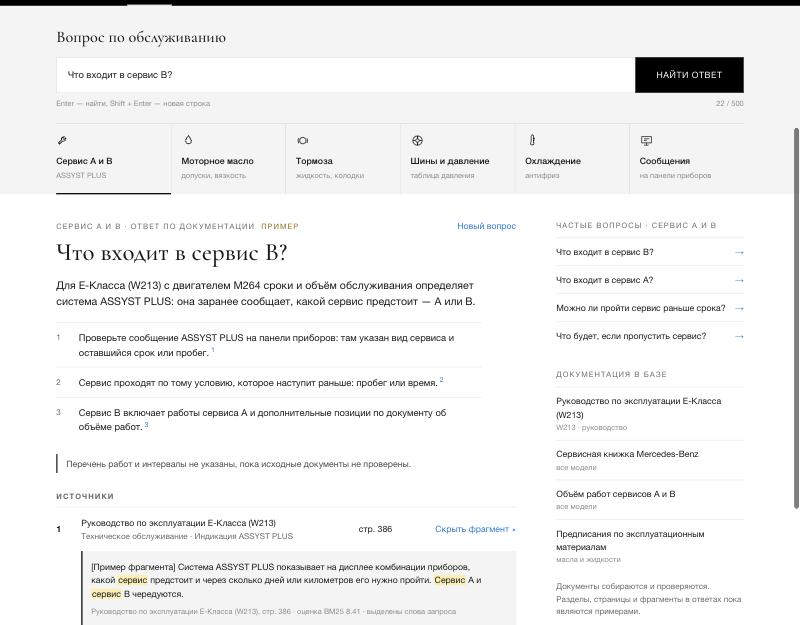
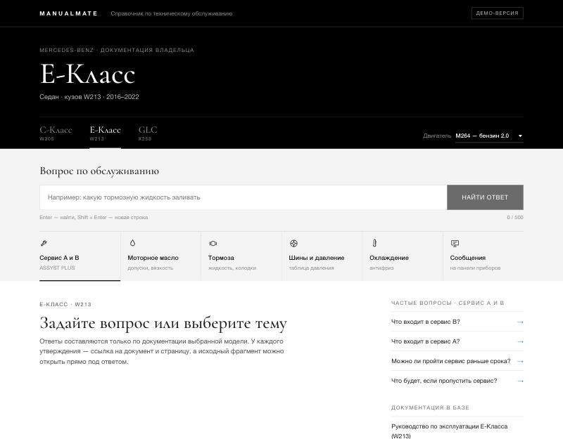
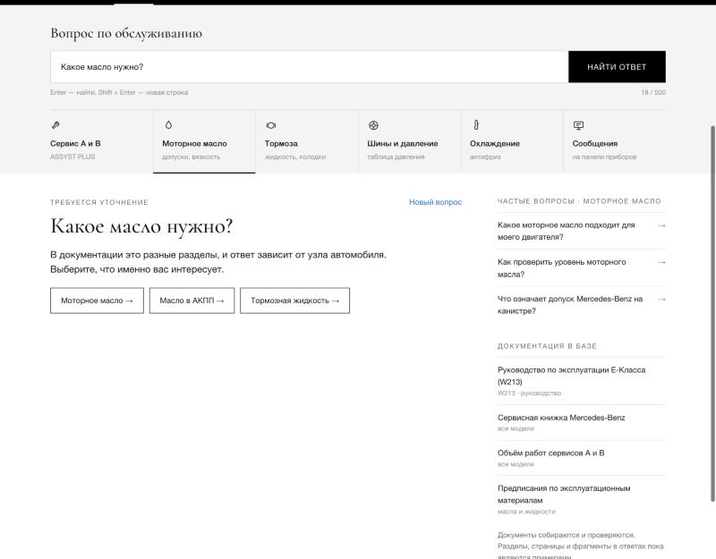
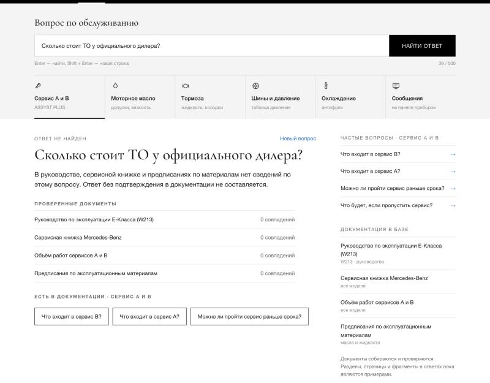
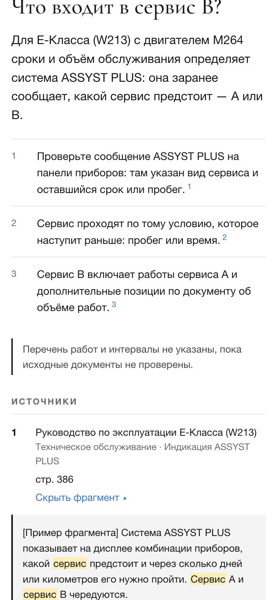
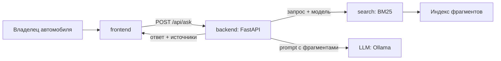

# ManualMate

Помощник по регламенту технического обслуживания автомобилей Mercedes-Benz. Отвечает на вопросы владельца по официальным документам: находит фрагменты руководств через BM25, формирует ответ с помощью LLM и показывает документ и страницу, на которые опирается ответ.



## Тема и пользователь

**Тема:** помощник для консультирования по регламенту технического обслуживания автомобилей.

**Модели в базе знаний:** Mercedes-Benz C-класс (W205), E-класс (W213), GLC (X253), 2014–2022 годы выпуска. Модели выбраны потому, что у них общие двигатели (M274, M264, OM654), а значит, одни и те же сведения о маслах, жидкостях и сервисах встречаются сразу в нескольких документах.

**Пользователь:** владелец одной из этих машин, который хочет понять, что и когда нужно делать на обслуживании: что входит в сервис A и сервис B, какое масло допускается для его двигателя, как читать сообщения ASSYST PLUS. Ему важно проверить ответ по первоисточнику, а не верить чат-боту на слово.

Пример: «Что входит в сервис B на E-классе с двигателем M264?» → краткий ответ, список работ, источники «Руководство по эксплуатации E-класса, стр. N».

## Что готово сейчас

| Материал | Статус |
| --- | --- |
| Продуктовые и технические спецификации | Подготовлены, см. [spec/](spec/) |
| Интерфейс | Статический прототип в стиле справочника Mercedes-Benz: вкладки моделей, быстрые темы, ответ со сносками и фрагментами, уточнение, «ответ не найден», мобильная вёрстка — [frontend/](frontend/) |
| Контракт API | Описан в [spec/tech/api.md](spec/tech/api.md); точка подключения — `askAssistant()` в `frontend/script.js` |
| Backend, BM25, LLM | Спроектированы; реализации пока нет |
| Корпус и benchmark | Описаны состав, формат и методика; документы ещё собираются, метрик нет |

Все ответы в прототипе — демонстрационные. Они помечены в интерфейсе и не являются работой RAG.

## Запуск прототипа

Зависимости не нужны. Откройте `frontend/index.html` в браузере или поднимите локальный сервер:

```bash
python3 -m http.server 8080 --directory frontend
```

Затем откройте http://localhost:8080. Чтобы посмотреть состояние «ошибка сервера», откройте http://localhost:8080/?error=1.

| Начальный экран | Уточнение | Нет данных | Телефон |
| --- | --- | --- | --- |
|  |  |  |  |

## Архитектура рабочей версии

| Компонент | Технология | Назначение |
| --- | --- | --- |
| frontend | HTML, CSS, JavaScript | Выбор автомобиля, вопрос, ответ, источники и фрагменты |
| backend | Python 3.11+, FastAPI | API, фильтр по модели, сборка prompt, вызов поиска и LLM |
| search | Python, собственная реализация BM25, pymorphy3 | Предобработка текста, инвертированный индекс, ранжирование |
| llm | Ollama, открытая instruct-модель (выбирается по benchmark) | Ответ только по найденным фрагментам |
| corpus | PDF → текст по страницам → фрагменты с metadata | Руководства, сервисные материалы, спецификации жидкостей |



Готовые поисковые индексы (rank-bm25, Elasticsearch и т. п.) не используются: BM25 реализуется командой по [методическим указаниям](spec/tech/rag.md#поиск-bm25). Подробнее — [spec/tech/architecture.md](spec/tech/architecture.md).

## Структура репозитория

```text
.
├── README.md               описание и запуск
├── AGENTS.md               правила для кодингового агента
├── CONTRIBUTING.md         ветки, Pull Request, review
├── CHANGE_HISTORY.md       журнал значимых изменений
├── frontend/               прототип интерфейса
├── backend/                будущий FastAPI-сервис
├── search/                 будущий BM25: токенизатор, индекс, ранжирование
├── corpus/                 состав и формат корпуса
├── benchmark/              формат тестовых запросов и пример
├── spec/
│   ├── product/            продукт, сценарии, интерфейс
│   ├── tech/               архитектура, API, RAG, способ проверки
│   ├── team.md             команда и зоны ответственности
│   ├── plan.md             план и контрольные точки
│   └── decisions.md        журнал решений
├── docs/                   чек-лист точки, сценарий показа, источники, проверка
├── scripts/check_docs.py   проверка структуры и ссылок документации
└── .github/                шаблон PR и проверка в GitHub Actions
```

Подробнее — [docs/repository-structure.md](docs/repository-structure.md).

## Документация

| Раздел | Документы |
| --- | --- |
| Продукт | [Продукт](spec/product/product.md) · [Сценарии](spec/product/scenarios.md) · [Интерфейс](spec/product/interface.md) |
| Техника | [Архитектура](spec/tech/architecture.md) · [API](spec/tech/api.md) · [RAG и BM25](spec/tech/rag.md) · [Способ проверки](spec/tech/testing.md) |
| Организация | [Команда](spec/team.md) · [План](spec/plan.md) · [Решения](spec/decisions.md) · [Правила работы](CONTRIBUTING.md) · [Правила для агента](AGENTS.md) |
| Контрольная точка 1 | [Чек-лист](docs/checkpoint-1.md) · [Сценарий показа](docs/demo-script.md) · [Проверка](docs/verification.md) · [Источники](docs/sources.md) |

## Проверка документации

```bash
python3 scripts/check_docs.py
```

Скрипт проверяет обязательные файлы, локальные ссылки в Markdown и формат примера benchmark. Он же запускается в GitHub Actions на каждый push и Pull Request.

## Команда

| Участник | Роль | Зона ответственности |
| --- | --- | --- |
| Парахневич Алексей ([@Renegade19](https://github.com/Renegade19)) | Backend | FastAPI, контракт API, BM25-индекс и поиск, интеграция, CI |
| Александров Георгий ([@AlexandrovG](https://github.com/AlexandrovG)) | LLM | Корпус и предобработка текста, prompt и выбор модели, benchmark и метрики |
| Черников Арсений ([@arseniy9606](https://github.com/arseniy9606)) | Frontend | Сценарии, интерфейс, подключение к API, внешний вид |

Задачи по участникам и контрольным точкам — [spec/team.md](spec/team.md) и [spec/plan.md](spec/plan.md).
