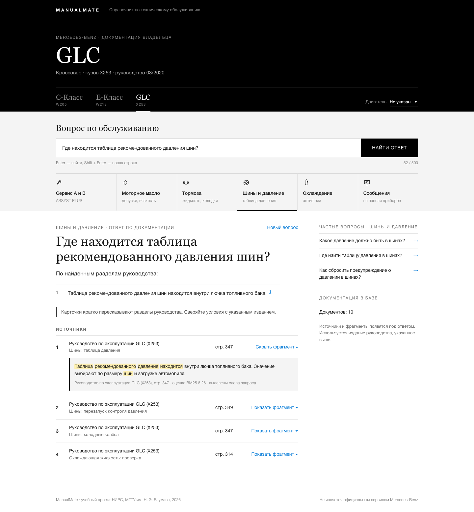
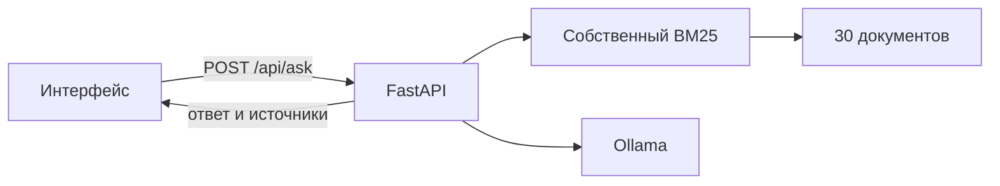

# ManualMate

Помощник по техническому обслуживанию Mercedes-Benz C-класса W205, E-класса W213 и GLC X253. Находит документы собственным поиском BM25, формирует ответ локальной LLM и показывает источники с номерами страниц.



## Тема и пользователь

Пользователь — владелец автомобиля, которому нужны сведения об обслуживании с возможностью проверить первоисточник. Корпус охватывает ASSYST PLUS, проверку и долив моторного масла, давление шин и меры предосторожности при проверке охлаждающей жидкости.

## Что реализовано

| Компонент | Результат |
| --- | --- |
| Интерфейс | Выбор автомобиля, вопрос, ответ, источники и фрагменты, уточнение, отказ, обработка ошибок |
| Backend | FastAPI: `/api/ask`, `/api/vehicles`, `/api/health` |
| Поиск | Собственные инвертированный индекс и BM25, лемматизация pymorphy3, фильтр по модели |
| LLM | Ollama, `qwen2.5:7b`, ответ по найденному контексту |
| Корпус | 30 документов D01–D30: адаптированные разделы трёх руководств с привязкой к страницам |
| Benchmark | 10 обычных вопросов с эталонами и ≥3 релевантными документами, 5 ловушек, четыре метрики |

## Запуск системы

Python 3.11+ и [Ollama](https://ollama.com/download). Команды выполняются из корня репозитория.

```bash
python3 -m venv .venv
source .venv/bin/activate
python -m pip install -r requirements.txt
```

Запустить приложение Ollama или `ollama serve` в отдельном терминале, загрузить модель и запустить сервер:

```bash
ollama pull qwen2.5:7b
python -m uvicorn backend.app:app --host 127.0.0.1 --port 8000
```

Интерфейс: <http://127.0.0.1:8000>. Состояние сервиса: <http://127.0.0.1:8000/api/health>. Документация API: <http://127.0.0.1:8000/docs>.

Готовые документы включены в репозиторий. Индекс строится автоматически при запуске и сохраняется в `.cache/index.json`. Адрес и модель Ollama задаются переменными `OLLAMA_URL` и `OLLAMA_MODEL`.

## Повтор проверки

```bash
python3 scripts/check_docs.py
python -m pytest -q
python -m benchmark.run --retrieval-only --output tmp/retrieval.json
python -m benchmark.run --output benchmark/results/repeat.json
python -m benchmark.score benchmark/results/kt2.json benchmark/results/kt2-reviews.json
```

Полный прогон заново вызывает LLM на всех 15 вопросах и сохраняет выдачу и ответы. Accuracy оценивается по полноте эталона и сохранению условий; оценки относятся к конкретному прогону. Последняя команда пересчитывает четыре метрики сохранённого результата. Методика и разбор ошибок — [benchmark/README.md](benchmark/README.md).

## Запуск прототипа

Прототип КТ1 сохранён отдельно от рабочего режима:

```bash
python3 -m http.server 8080 --directory frontend
```

Адрес: <http://localhost:8080/?demo=1>. Демо-ответы помечены в интерфейсе и не участвуют в benchmark.

## Архитектура



## Структура репозитория

| Каталог | Содержимое |
| --- | --- |
| `frontend/` | HTML, CSS, JavaScript и API-клиент |
| `backend/` | FastAPI и вызов Ollama |
| `search/` | Предобработка, индекс, BM25 |
| `corpus/` | Manifest, источники, документы D01–D30 |
| `benchmark/` | Вопросы, метрики, результаты прогонов |
| `tests/` | Тесты поиска, API и benchmark |
| `spec/` | Продуктовые и технические спецификации, команда и план |
| `docs/` | Контрольные точки, источники и скриншоты |
| `scripts/` | Подготовка корпуса и проверка документации |
| `.github/` | Workflow и шаблон Pull Request |

## Документация

[КТ1](docs/checkpoint-1.md) · [КТ2](docs/checkpoint-2.md) · [Архитектура](spec/tech/architecture.md) · [API](spec/tech/api.md) · [Поиск](spec/tech/rag.md) · [Проверки](spec/tech/testing.md) · [Команда](spec/team.md) · [Правила работы](CONTRIBUTING.md)

## Команда

| Участник | Роль |
| --- | --- |
| Парахневич Алексей ([@Renegade19](https://github.com/Renegade19)) | Backend |
| Александров Георгий ([@AlexandrovG](https://github.com/AlexandrovG)) | LLM |
| Черников Арсений ([@arseniy9606](https://github.com/arseniy9606)) | Frontend |
