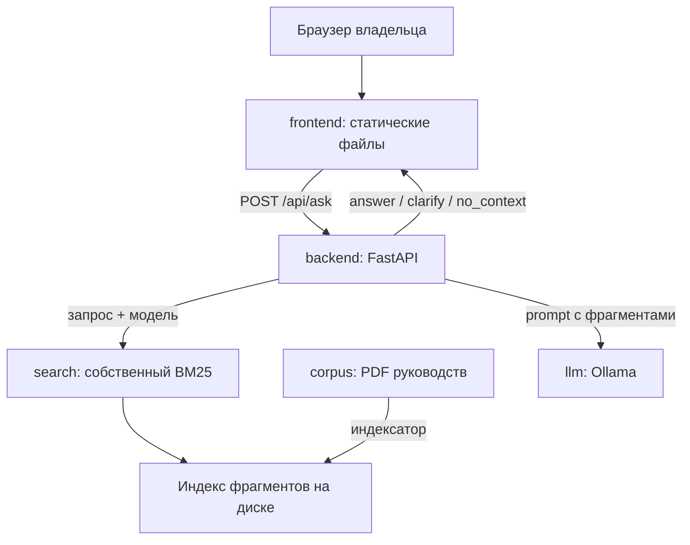

# Архитектура

## Статус

Целевая архитектура. На контрольной точке 1 в репозитории есть документация и статический прототип интерфейса; backend, поиск и LLM ещё не реализованы.

## Компоненты



| Компонент | Технология | Порт (dev) | Ответственный |
| --- | --- | --- | --- |
| frontend | HTML, CSS, JS | 8080 | Frontend |
| backend | Python 3.11+, FastAPI, Uvicorn | 8000 | Backend |
| search | Python-модуль внутри backend | — | Backend (индекс, BM25), LLM (предобработка) |
| indexer | Python-скрипт, запускается вручную | — | Backend |
| llm | Ollama | 11434 | LLM |

На первом этапе поиск — модуль внутри backend, а не отдельный сервис. Если это изменится, запись появится в [журнале решений](../decisions.md).

## Путь запроса

1. Frontend отправляет `POST /api/ask`: вопрос и выбранный автомобиль (модель, двигатель).
2. Backend проверяет ввод: вопрос не пустой и не длиннее 500 символов, модель известна.
3. `preprocess()` превращает вопрос в термы: нижний регистр, сохранение обозначений, лемматизация, стоп-слова, синонимы.
4. Если запрос неоднозначен — ответ `clarify` с вариантами, без поиска и LLM.
5. BM25 ранжирует только фрагменты, у которых в metadata есть выбранная модель (или пометка «все модели»).
6. Если лучший score ниже порога — ответ `no_context`, LLM не вызывается.
7. Иначе собирается prompt: инструкция, top-k фрагментов с номерами `[1]…[k]`, вопрос, модель автомобиля.
8. LLM формирует ответ; backend проверяет, что ссылки `[N]` указывают на переданные фрагменты.
9. Backend возвращает текст, пункты и `sources` из metadata фрагментов.

## Подготовка корпуса

1. PDF лежат локально в `corpus/raw/` (в Git не попадают), их список и хеши — в `corpus/manifest.json`.
2. Текст извлекается постранично с сохранением номера страницы печатного руководства.
3. Страницы делятся на фрагменты по заголовкам разделов; таблицы регламента — построчно.
4. Каждый фрагмент получает metadata: `chunk_id`, `doc_id`, `models`, `engines`, `section`, `page`, `text`.
5. Индексатор вызывает `preprocess()`, строит инвертированный индекс и статистики BM25 и сохраняет их на диск.

Подробнее — [rag.md](rag.md).

## Контракт между модулями

Граница между зонами Backend и LLM — две функции. Сигнатуры не меняются без обновления этого раздела.

```python
# search/preprocess.py — пишет LLM, вызывает Backend
def preprocess(text: str) -> list[str]:
    """Термы для индекса и запроса. Одна функция для обоих случаев."""

# backend/llm/answer.py — пишет LLM, вызывает Backend
def generate_answer(question: str, vehicle: Vehicle, chunks: list[Chunk]) -> Answer:
    """Ответ только по chunks. Answer.citations — номера использованных фрагментов."""
```

```python
# search/bm25.py — пишет Backend
def search(query_terms: list[str], model_code: str, top_k: int = 5) -> list[ScoredChunk]:
    """BM25 по фрагментам выбранной модели, по убыванию score."""
```

## Размещение

Для разработки и показа всё запускается локально на ноутбуке команды. Модель LLM выбирается так, чтобы поместиться в его память; выбор фиксируется в журнале решений.

## Безопасность

- Ответ модели выводится как текст, не как HTML.
- В корпус и логи не попадают персональные данные и VIN.
- CORS backend разрешает только адрес frontend.
- Исходные PDF не публикуются в репозитории.
